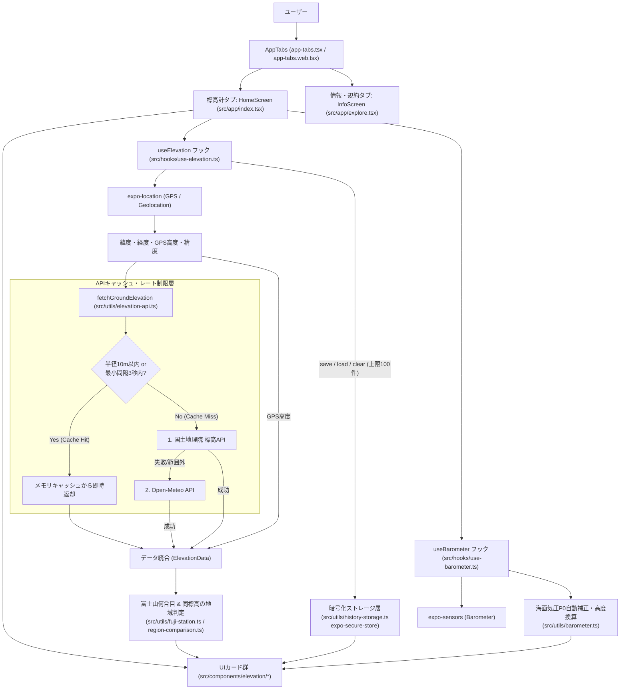

# 現在地の標高計アプリ 設計書（改訂版 v2.0）

最終更新日: 2026-10-18

---

## 1. システム概要

### 1.1 目的
スマートフォン（Android / iOS）およびPCのWebブラウザの位置情報（GPS等）と気圧センサーを利用して、現在地の**標高（海抜・メートル単位）**をリアルタイムかつ高精度に取得・比較・記録・可視化するアプリケーション。

### 1.2 主な特徴と改修優先度

| 優先度 | 機能分類 | 概要 |
| :---: | :--- | :--- |
| **コア** | **ハイブリッド標高取得 & 富士山何合目換算** | 国土地理院 標高API（0.1m単位）→ Open-Meteo DEM → 端末GPS高度のフォールバック取得と、富士山（3,776m）の何合目相当かの表示。 |
| **最優先 (P1)** | **履歴データの端末内永続化と暗号化** | `expo-secure-store`（Android Keystore / iOS Keychain による暗号化ストレージ）を導入し、アプリを閉じても端末内に安全に履歴を保持する。**保存件数の上限は最大100件**。 |
| **高 (P2)** | **同じ標高の地域・名所比較機能** | 現在の標高（海抜）が**日本国内や世界のどの地域・都市・高原の標高と同じくらいか**（例：東京駅 5m、新宿駅 37m、京都・清水寺 65m、松本市 590m、軽井沢 940m、上高地 1,500m など）を自動検索して表示する機能。 |
| **中 (P3)** | **自動追従時のAPIキャッシュ・レート制限** | 半径10m以内の同一地点キャッシュおよび最小通信間隔制御により、自動追従（Watch）中の外部API通信頻度とバッテリー消費を大幅に削減。 |
| **低 (P4)** | **標高推移グラフ表示 & 気圧センサー連携** | 記録した標高履歴の高低差・推移グラフ表示と、`expo-sensors`（`Barometer`）による気圧（hPa）・気圧換算高度の補助表示。 |

---

## 2. 技術スタック・動作環境

| カテゴリ | 採用技術 / バージョン | 用途・備考 |
| :--- | :--- | :--- |
| フレームワーク | Expo (`~57.0.0`) / React Native (`0.86.3`) | クロスプラットフォームモバイル＆Web開発基盤（Expo Go 57.0.9 互換） |
| UIライブラリ | React (`19.2.3`) | コンポーネントレンダリング（React Compiler有効） |
| 言語 | TypeScript (`~6.0.3`) | 静的型付けによる品質担保 |
| ルーティング | Expo Router (`~57.0.28`) | ファイルベースルーティング（`src/app/`） |
| 位置情報取得 | `expo-location` (`~57.0.21`) | OSネイティブおよびブラウザGeolocation APIのラッパー |
| 暗号化永続化 | `expo-secure-store` (`~57.0.x`) | 標高履歴データの端末内暗号化保存（Web環境は `localStorage` フォールバック） |
| 気圧センサー | `expo-sensors` (`~57.0.x` - `Barometer`) | 端末内蔵の気圧センサー（hPa）取得・気圧換算高度算出 |
| テスト基盤 | Jest (`jest-expo`) / `@testing-library/react-native` | TDD（単体テスト・結合テスト）実行環境 |
| 外部API (主系) | 国土地理院 標高API | 日本国内の航空レーザー測量 / 写真測量による高精度標高取得 |
| 外部API (副系) | Open-Meteo Elevation API | グローバル対応の数値標高モデル（フォールバック用） |

---

## 3. システム構成・アーキテクチャ

### 3.1 全体アーキテクチャ図



### 3.2 ディレクトリ・ファイル構成

```text
project_202610/
├── app.json                      # Expoアプリ設定（最小権限・versionCode・スプラッシュ・アダプティブアイコン設定）
├── package.json                  # 依存パッケージ・スクリプト・Jest設定（@/assets/* モック対応）
├── tsconfig.json                 # TypeScript設定
├── assets/
│   └── images/                   # 専用デザイン（高度計文字盤＋富士山シルエット）アイコン・スプラッシュ画像群
│       ├── icon.png                      # メインアプリアイコン (1024×1024)
│       ├── android-icon-foreground.png   # Android アダプティブアイコン前景 (512×512)
│       ├── android-icon-background.png   # Android アダプティブアイコン背景 (512×512)
│       ├── android-icon-monochrome.png   # Android 13+ テーマアイコン用モノクロ画像 (432×432)
│       ├── splash-icon.png               # 起動スプラッシュ & 画面内ヘッダーエンブレム (512×512)
│       ├── expo-logo.png                 # AnimatedSplashOverlay 用ロゴ (512×512)
│       └── favicon.png                   # Webブラウザ用ファビコン (64×64)
├── doc/
│   ├── design.md                 # 本設計書（v2.1 最新ソース同期版）
│   ├── test-spec.md              # テスト仕様書・TDD実行結果（全22テスト）
│   ├── privacy-policy.md         # 公開用プライバシーポリシー全文 & Google Play データセーフティ回答ガイド
│   ├── retrospective-and-roadmap.md # 改修ロードマップ・対応状況ドキュメント
│   └── prompt-retrospective.md   # 開発の振り返り（プロンプトの評価と改善ヒント）
└── src/
    ├── global.css                # Webフォント定義・モバイルビューポート横幅制約 (overflow-x: hidden)
    ├── __tests__/
    │   └── elevation-test.tsx    # 単体・結合テストスイート（TC-01〜TC-23：全22テスト）
    ├── app/                      # Expo Router 画面定義
    │   ├── _layout.tsx           # ルートレイアウト・スプラッシュ制御・テーマプロバイダー
    │   ├── index.tsx             # 「標高計」ホーム画面（各カードと操作ボタンの組み立て）
    │   └── explore.tsx           # 「情報・規約」画面（InfoScreen：データの仕組み・プライバシーポリシー・出典）
    ├── components/
    │   ├── elevation/            # 標高計専用UIカードコンポーネント群
    │   │   ├── elevation-hero-card.tsx    # メイン標高（海抜）表示カード
    │   │   ├── fuji-station-card.tsx      # 同じ標高の地域比較（初期表示） & 富士山何合目切替カード
    │   │   ├── elevation-detail-card.tsx  # 計測データ詳細（DEM・GPS・気圧2行表示・精度警告）カード
    │   │   ├── elevation-chart-card.tsx   # 標高推移グラフカード（buildElevationChartModel 含む）
    │   │   └── elevation-history-card.tsx # 標高の記録履歴一覧（最大100件）・クリアカード
    │   ├── animated-icon.tsx     # 起動時スプラッシュアニメーションオーバーレイ
    │   ├── app-tabs.tsx          # ネイティブ用下部タブバー（「標高計」/「情報・規約」）
    │   ├── app-tabs.web.tsx      # Web用上部ナビゲーションバー（アイコン＋「現在地の標高計」＋タブ切替）
    │   ├── themed-text.tsx
    │   └── themed-view.tsx
    ├── hooks/
    │   ├── use-elevation.ts      # 位置情報・標高取得・暗号化履歴State管理フック
    │   ├── use-barometer.ts      # 気圧センサー購読・海面気圧P0キャリブレーション管理フック
    │   ├── use-color-scheme.ts
    │   ├── use-color-scheme.web.ts
    │   └── use-theme.ts
    ├── utils/
    │   ├── elevation-api.ts      # 標高API通信＋空間キャッシュ（10m/10分）・レート制限（3秒）ロジック
    │   ├── barometer.ts          # 気圧換算高度・基準海面気圧P0逆算の純粋数学関数
    │   ├── history-storage.ts    # expo-secure-store 暗号化永続化（上限100件・1,500文字チャンク分割）
    │   ├── region-comparison.ts  # 同じ標高の地域・都市・名所マッチングロジック（28スポット収録）
    │   ├── fuji-station.ts       # 富士山（3,776m）何合目判定ロジック
    │   └── format.ts             # メートル表記・緯度経度フォーマット関数
    └── constants/
        └── theme.ts              # カラー定義・セマンティックパレット（ElevationPalette）・余白定数
```

---

## 4. 新規・改修機能の詳細設計（優先度順）

### 4.1 【優先度1 (P1)】履歴データの端末内永続化と暗号化（`src/utils/history-storage.ts`）

#### (1) 要件と保存上限
- アプリを終了・再起動しても記録した標高履歴が消えないよう、`expo-secure-store` を用いて端末内の暗号化領域（Android: Keystore + EncryptedSharedPreferences / iOS: Keychain）に保存する。
- **最大保存件数（`MAX_HISTORY_ITEMS`）は `100` 件**とする。100件を超えた場合は、最も古い履歴から自動的に切り捨てる（FIFO / 先頭追加・末尾削除）。
- Webブラウザ環境（`Platform.OS === 'web'`）では `expo-secure-store` のネイティブモジュールが存在しないため、自動的に `localStorage` にフォールバックする。

#### (2) `expo-secure-store` の2,048バイト制限対策（チャンク分割保存）
- `expo-secure-store` の公式仕様上、1つのキーに2,048バイトを超える文字列を保存しようとすると一部のOS環境でエラーとなる制限がある。
- 履歴100件分のJSON（約10KB〜15KB）を安全に保存するため、`history-storage.ts` 内部でJSON文字列を **1チャンクあたり最大1,500文字（約1.5KB）** ごとに分割し、以下のキー構成で暗号化保存・結合復元する：
  - メタキー `elevation_history_meta_v1`: `{ chunkCount: number }`
  - データキー `elevation_history_chunk_0`, `elevation_history_chunk_1`, ...
- これにより、OSのサイズ制限に抵触せず確実に100件まで暗号化保存できる。

#### (3) インターフェース定義
```typescript
export const MAX_HISTORY_ITEMS = 100;

export async function loadElevationHistory(): Promise<ElevationHistoryItem[]>;
export async function saveElevationHistory(items: ElevationHistoryItem[]): Promise<ElevationHistoryItem[]>;
export async function clearElevationHistory(): Promise<void>;
```

---

### 4.2 【優先度2 (P2)】同じ標高の地域・名所比較モード（`src/utils/region-comparison.ts`, `fuji-station-card.tsx`）

#### (1) 機能概要
現在の標高（海抜 `m`）に対して、**「日本国内や世界のどの地域・都市・観光地・高原の標高と同じくらいか」** を検索し、最も標高が近い地域（ベストマッチ）と近傍の同標高帯スポットを表示する。
UI上では **初期表示を「🗺️ 同じ標高の地域モード」** とし、ワンタップで「🗻 富士山何合目モード」と切り替えられるようにする。

#### (2) 同標高地域マスターデータの代表例（0m〜3,776m）

| 標高帯 | 登録地域・スポットの例（代表標高） | 特徴・コメント |
| :--- | :--- | :--- |
| **0m 〜 5m** | 東京都・築地 / 豊洲周辺（`2m`）、大阪市・梅田駅周辺（`3m`）、横浜みなとみらい（`4m`） | 臨海部・湾岸エリアと同じ高さ |
| **5m 〜 15m** | 東京駅・丸の内周辺（`5m`）、福岡市・博多駅周辺（`8m`）、名古屋駅周辺（`10m`） | 日本の主要ターミナル駅の平地と同じ高さ |
| **15m 〜 35m** | 札幌駅周辺（`18m`）、東京都・渋谷駅ハチ公前（`19m`）、JR京都駅周辺（`28m`） | 扇状地や谷あいの都市中心部と同じ高さ |
| **35m 〜 60m** | 東京都・新宿駅周辺（`37m`）、東京都・吉祥寺駅周辺（`55m`） | 武蔵野台地などの高台エリアと同じ高さ |
| **60m 〜 150m** | 神戸・北野異人館街（`65m`）、京都・清水寺（`85m`）、京都・嵐山渡月橋（`120m`） | 丘陵地・山麓の観光名所と同じ高さ |
| **150m 〜 400m** | 福島県・会津若松市（`215m`）、埼玉県・秩父市（`230m`）、長野市・善光寺周辺（`370m`） | 内陸の盆地・門前町と同じ高さ |
| **400m 〜 800m** | 神奈川県・箱根強羅（`550m`）、岐阜県・高山市街（`570m`）、長野県・松本城周辺（`590m`） | 温泉街や信州・飛騨の城下町と同じ高さ |
| **800m 〜 1,300m** | 山梨県・河口湖畔（`830m`）、長野県・軽井沢駅周辺（`940m`）、栃木県・中禅寺湖（`1,269m`） | 人気の高原リゾート・山上湖と同じ高さ |
| **1,300m 〜 2,000m** | 長野県・白樺湖（`1,416m`）、長野県・上高地河童橋（`1,500m`）、米国・デンバー市（`1,609m`） | 本格的な山岳景勝地・高原都市と同じ高さ |
| **2,000m 〜 3,800m** | 長野県・美ヶ原高原（`2,000m`）、富山県・立山室堂（`2,450m`）、長野県・乗鞍岳畳平（`2,702m`） | 雲上のアルペンルート・高山帯と同じ高さ |

#### (3) データ構造（`RegionComparisonResult`）
```typescript
export interface ElevationRegionSpot {
  id: string;
  name: string;         // 例: "東京都・新宿駅周辺"
  prefectureOrCountry: string; // 例: "東京都"
  elevation: number;    // 例: 37
  description: string;  // 例: "武蔵野台地の東端に位置する副都心エリア"
}

export interface RegionComparisonResult {
  /** 現在の標高に最も近い地域スポット */
  closestSpot: ElevationRegionSpot;
  /** 現在の標高との差 (m, 絶対値) */
  elevationDiff: number;
  /** 同標高帯で他に高度が近い地域スポット（最大2件） */
  nearbySpots: ElevationRegionSpot[];
}

export function findSameElevationRegions(
  elevation: number | null
): RegionComparisonResult | null;
```

---

### 4.3 【優先度3 (P3)】自動追従モード時のAPIキャッシュ・レート制限（`src/utils/elevation-api.ts`）

#### (1) 空間キャッシュ（近傍地点のキャッシュ再利用）
- 自動追従（`watchPositionAsync`）中、わずかなGPSの揺らぎや停止中に毎回国土地理院APIへリクエストを送るのを防ぐため、直近の取得結果をメモリキャッシュに保持する。
- **キャッシュヒット条件**：
  1. 前回取得した座標からの移動距離（Haversine距離）が **`10m` 以内** であること
  2. キャッシュ取得時刻から **有効期限（TTL：10分間 = `600,000ms`）以内** であること
- 上記を満たす場合は外部APIへのHTTP通信を行わず、キャッシュされた標高とデータソースを即時返却する。

#### (2) レート制限（スロットリング）
- 移動距離が `10m` を超えた場合でも、前回の外部APIリクエストから **最小通信間隔（`MIN_API_INTERVAL_MS = 3000` ミリ秒）** が経過していない場合は、直近のキャッシュ値（または端末GPS高度）を返し、短時間の連続リクエスト集中を防止する。
- 単体テストや手動リフレッシュ時にキャッシュをリセットできるよう `clearElevationCache()` 関数も公開する。

---

### 4.4 【優先度4 (P4)】標高推移グラフ表示 & 気圧センサー連携

#### (1) 標高推移グラフカード（`src/components/elevation/elevation-chart-card.tsx`）
- 記録された履歴（`history`）が1件以上ある場合に表示する視覚化カード。純粋関数 `buildElevationChartModel(history)` によってグラフ描画用モデルを生成する。
- 直近の記録データ（最大 `MAX_CHART_POINTS = 20` ポイント分のスライディングウィンドウ）について：
  - 記録件数が20件を超えた場合は `直近 20 地点 (#2〜#21)` のように通し番号を自動でスライド表示し、フッターに `最新 #21: XX.X m (HH:MM:SS)` を明示する。
  - **最高標高 (`Max`)** / **最低標高 (`Min`)** / **高低差 (`Δm`)** のサマリー表示。
  - 各記録ポイントの標高を相対高さバー（棒グラフ・最新バーはティールグリーン強調）として視覚的に並べて表示する。

#### (2) 気圧センサー連携と自動キャリブレーション（`src/utils/barometer.ts`, `src/hooks/use-barometer.ts`, `ElevationDetailCard`）
- 気圧計算の純粋関数は `src/utils/barometer.ts` に分離し、センサーライフサイクル管理は `src/hooks/use-barometer.ts` で行う。
- `expo-sensors` の `Barometer` を使用し、端末に気圧センサーが搭載されているか（`Barometer.isAvailableAsync()`）を判定する。
- 天候（高気圧・低気圧）による海面気圧のズレ（最大 $\pm 100 \sim 200\text{ m}$ 相当）を解消するため、国土地理院API/DEMで取得した正確な地表標高 $h_{\text{ref}}$ と現在気圧 $P_{\text{ref}}$ から、その日の**基準海面気圧 $P_0$ を自動で逆算・補正（キャリブレーション）**する：
  $$P_0 = \frac{P_{\text{ref}}}{\left(1 - \frac{h_{\text{ref}}}{44330}\right)^{\frac{1}{0.190295}}}, \quad h = 44330 \times \left(1 - \left(\frac{P}{P_0}\right)^{0.190295}\right)$$
- `ElevationDetailCard`（計測データの詳細）内の「**気圧センサー（気圧 / 換算高度）**」行では、小さな画面でも右側が見切れないよう**右寄せ2行レイアウト**で表示する：
  - 1行目：`1025.6 hPa`
  - 2行目：`（-1.1 m・補正済）`（未補正時は `（XX.X m）`、センサー非搭載端末やWeb環境では `未搭載 / 非対応`）

---

## 5. 画面設計（UI構成・2タブ構成）

### 5.1 タブ1：「標高計」ホーム画面（`src/app/index.tsx`）

| 順番 | コンポーネント | 表示内容・操作 |
| :---: | :--- | :--- |
| 0 | ヘッダー | 専用デザインの高度計エンブレムアイコン（`56×56px`）＋ `ALTITUDE & ELEVATION` ＋ `現在地の標高計` |
| 1 | `ElevationHeroCard` | 現在の標高（海抜 `XX.X m`）とデータソースバッジ |
| 2 | `FujiStationCard` | **比較モード切替タブ（初期表示：🗺️ 同じ標高の地域 / 切替：🗻 富士山何合目）**：現在地と同じ標高の地域・代表標高・標高差・近傍スポット、または富士山の合目・達成率・頂上までの残り距離を表示 |
| 3 | 操作ボタン群 | 「現在地を再取得」「自動追従 (ON/OFF)」「現在の標高を記録（最大100件・暗号化保存）」 |
| 4 | `ElevationDetailCard` | 地表の標高（DEM）、GPSセンサー高度、**現在気圧（hPa）＆気圧換算高度（2行表示）**、緯度/経度、水平精度（100m超で警告）、最終取得時刻 |
| 5 | `ElevationChartCard` | 記録履歴の標高推移グラフ（最高・最低・高低差 $\Delta\text{m}$・直近20地点スライディングバー・最新記録サマリー） |
| 6 | `ElevationHistoryCard` | 暗号化保存された履歴一覧（最大100件表示）と「履歴をクリア」ボタン |
| 7 | フッター | 出典（国土地理院 標高API / Open-Meteo DEM）および端末内暗号化保存のプライバシー明記 |

### 5.2 タブ2：「情報・規約」画面（`src/app/explore.tsx` - `InfoScreen`）

Google Play ストア審査要件（アプリ内からのプライバシーポリシー参照）および利用者への透明性確保のため、以下のカードを表示する：

| 順番 | カード項目 | 表示内容 |
| :---: | :--- | :--- |
| 0 | ヘッダー | 高度計エンブレムアイコン（`56×56px`）＋ `ABOUT & PRIVACY POLICY` ＋ `アプリ情報・利用規約` |
| 1 | アプリ概要カード | アプリ名「現在地の標高計」、バージョンバッジ（`v1.0.0`）、機能概要 |
| 2 | `📐 標高・高度データの仕組み` | ①地表の標高（国土地理院 / Open-Meteo DEM）、②端末GPSセンサー高度（オフライン対応）、③気圧センサーと海面気圧（$P_0$）自動補正の解説 |
| 3 | `🔒 プライバシーポリシー` | ①取得する情報と利用目的（フォアグラウンドのみ）、②外部APIへの送信範囲（緯度・経度のみ、個人情報は非送信）、③記録履歴データの端末内暗号化保存と削除方法、④免責事項 |
| 4 | `📚 データ出典・ライセンス表記` | 国土地理院 標高API / Open-Meteo.com Elevation API (Copernicus DEM GLO-90, CC BY 4.0) |

---

## 6. セキュリティ・最小権限・対応OS設計

### 6.1 最小権限の原則（Principle of Least Privilege）
- **位置情報権限**：フォアグラウンド権限（`ACCESS_COARSE_LOCATION`, `ACCESS_FINE_LOCATION`）のみ要求し、バックグラウンド位置情報権限（`ACCESS_BACKGROUND_LOCATION` 等）は `blockedPermissions` で明示的に遮断。
- **気圧センサー**：Android / iOS ともに気圧センサー（`Barometer`）の読み取りには特別な危険権限（Dangerous Permission）は不要。
- **暗号化ストレージ**：`expo-secure-store` により端末内の暗号化領域にのみ履歴を保存し、外部サーバーへの送信は一切行わない。`ios.config.usesNonExemptEncryption: false` を `app.json` に設定し、App Store 提出時の暗号化コンプライアンス申告にも対応する。

### 6.2 対応OSバージョン（Expo SDK 57 基準）
- **Android**：Android 7.0（APIレベル 24）以上（ターゲット：API 35+、`versionCode: 1`）
- **iOS**：iOS 15.1 以上
