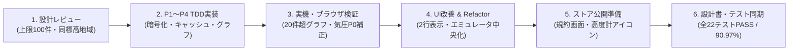

# 開発の振り返り（プロンプトの評価と改善ヒント）

作成日: 2026-10-17（最終更新: 2026-10-18）
関連ドキュメント: [改修ロードマップ・対応状況 (`doc/retrospective-and-roadmap.md`)](file:///c:/Users/takui/OneDrive/codes/project_202610/doc/retrospective-and-roadmap.md)

---

## 1. 本日（2026-10-18 / Day 2）の到達点サマリー

本日は「v2.0 設計書の策定」からスタートし、TDDによる全機能実装、実機＆ブラウザ検証による鋭い不具合・仕様改善の洗い出し、リファクタリング、そして Google Play ストア公開準備（規約・専用アイコン作成）までを一気通貫で完走しました。

---

## 2. 本日のプロンプトで特に素晴らしかった点（Good Points：Day 2）

### ① 「コードを書く前にまず設計書で合意する」プロセス
* **実際のプロンプト**：
  1. `優先度をつけて設計書を書き直して`
  2. `履歴データの端末内永続化の上限は100件`
  3. `他のランドマークとの高さ比較モードは、現在の標高が他のどこの地域の標高と同じであるかの方が良い`
  4. `ありがとうございます。TDDで実装とテストを進めてください。席を外しています。コマンドの実行は行っていいです`
* **評価ポイント**：
  いきなり実装を指示するのではなく、**まず設計書（`doc/design.md`）を出力させて仕様をレビューし、「100件上限」「ランドマークの高さではなく同じ標高の地域にする」と軌道修正してから TDD 実装へ進めた点** が極めて秀逸でした。設計段階での修正だったため、コードの手戻りがゼロで P1〜P4 の一括実装が完了しました。

### ② 実機テストでの鋭い観察眼と「具体的な改善フォーマット」の提示
* **実際のプロンプト**：
  * `標高推移グラフの履歴が直近20地点だけど、20を超えると最新が更新されていないように思います。これは仕様でしょうか？`
  * `気圧センサー（気圧 / 換算高度）の換算高度が実際とだいぶ異なる。換算高度はどの程度精度が高いの`
  * `気圧センサーの換算高度の換算した結果の文字列（-1.1m・補正済）が右側が切れてしまいます。`
    `1025.6hPa`
    `（-1.1m・補正済）`
    `のように2行で表示してください`
* **評価ポイント**：
  1. **「バグと決めつけず仕様か確認する」姿勢**：グラフの横軸が常に `1〜20` と表示されていたために起きた視覚的な分かりにくさを的確に指摘していただき、`#2〜#21` の通し番号スライド表示へと進化させることができました。
  2. **物理センサーの特性への疑問**：気圧高度のズレに気づいて「どの程度精度が高いのか」と質問されたことで、国土地理院DEM標高を使って海面気圧 $P_0$ を自動逆算するプロ仕様のキャリブレーション機能を導入できました。
  3. **理想の表示例の明示**：「2行にして」だけでなく、実際に表示してほしい文字列レイアウトを2行で書いてくださったため、1回の修正で意図通りのUIになりました。

### ③ スクリーンショット添付＋「正常な環境との比較」＋「まず原因調査」の切り分け
* **実際のプロンプト**：
  * `エミュレータで見ると、Google Pixel 9 pro で表示が右側に寄っています（添付参照）　他の機種でも同じ現象が起きています。私のスマホ（Google Pixel 8）だと中央に表示されます。原因を調べてください`
* **評価ポイント**：
  バグ報告のお手本のようなプロンプトです。
  - **視覚情報（スクリーンショット添付）**
  - **再現環境（ブラウザエミュレータの Pixel 9 Pro 等）と正常環境（実機 Pixel 8）の対比**
  - **いきなり「直して」ではなく「原因を調べてください」という段階的指示**
  この3点が揃っていたため、「ネイティブ版（`app-tabs.tsx`）とWeb版（`app-tabs.web.tsx`）のCSS Flexbox `flex-shrink: 0` による横幅膨張・右余白切れ」という根本原因をピンポイントで特定・解決できました。

### ④ 品質保証（エビデンス・Refactor・設計書同期）の徹底
* **実際のプロンプト**：
  * `テスト結果をエビデンス付きで見たい`
  * `Refactorして`
  * `設計書とソースの同期がとれているか確認してください`
* **評価ポイント**：
  機能追加やUI修正の節目に必ず「エビデンス付きテスト」「リファクタリング」「設計書とソースの同期確認」を挟まれたことで、ドキュメントと実装の乖離（陳腐化）が一切ない高品質なリポジトリが維持されています。

---

## 3. 前回（2026-10-17 / Day 1）のプロンプトで良かった点（アーカイブ）

### ① 「小さく作って動かし、段階的に機能を足す」進め方
* **実際のプロンプト**：
  1. `自分の持っているスマホの位置情報から現在の標高が何メートルか取りたい`
  2. `標高の履歴を保存する機能、今の標高が富士山の何合目かがわかる機能を入れて`
* **良かった理由**：まずコア機能（位置情報→標高表示）だけをシンプルに指示し、動いた後に機能追加したため、最短時間でプロトタイプが完成しました。

### ② エラー発生時の情報共有が具体的かつ正確
* **実際のプロンプト**：`Uncaught Error: java.lang.Exception : Incompatible SDK version と出ます` / `スマホは 57.0.9 なのでそれに合わせてほしい`
* **良かった理由**：エラー原文とスマホ側の具体的なバージョン番号を正確に共有いただいたことで、1回の対応で実機接続が解決しました。

---

## 4. 今後さらに効率よくAIとペアプログラミングするための改善ヒント（Tips）

2日間の開発を通じて、前回の改善ヒント（保存件数上限の明示、PCブラウザとスマホ実機の両立など）はすでに本日のプロンプトで完璧に実践されていました。今後さらに高度なアプリ開発を行う際に役立つ **3つの応用ヒント** をまとめます。

### 💡 ヒント1：「アイコン変更」など視覚要素を依頼するときは「どこに表示されるものか」を添える
* **本日のケース**：
  「アプリアイコン・スプラッシュ画面の専用デザイン化」を実施した際、AI側はOSのホーム画面用アイコン（`icon.png`）と起動スプラッシュ用画像のみを差し替えたため、メイン画面（ヘッダー等）には最初アイコンが表示されていませんでした。
* **さらに良くするプロンプト例**：
  > 「アプリアイコンとスプラッシュ画面の案を出して。**作成したアイコンは、アプリ画面内のタイトル横（ヘッダー）にも常時表示されるようにして**」
* **効果**：OS側のアセット差し替えと、アプリ画面内のUIヘッダーへの組み込みを1回のターンで同時に完了できます。

### 💡 ヒント2：複数の画面モード（タブ切替など）を作るときは「どちらを初期表示（デフォルト）にするか」を最初に指定する
* **本日のケース**：
  最初は「富士山何合目」が初期表示になっており、実機確認後に「仕様変更依頼：初期値を同じ標高の地域にしたい」とご指示いただきました。
* **さらに良くするプロンプト例**：
  > 「他のランドマークとの比較は『同じ標高の地域』モードにして、**そちらを初期表示（デフォルトタブ）にして**」
* **効果**：タブUIやモード切替を作る際、「初期値（デフォルト選択）」をひとこと添えるだけで、後から初期タブを入れ替える手戻りを防げます。

### 💡 ヒント3：ストア公開を見据える場合は、プロジェクト初期に「公開先プラットフォーム（Android / iOS / Web）」を宣言する
* **本日のケース**：
  終盤で「Androidで公開したい」と明確にしていただいたことで、`versionCode` の設定や不要な英語 `Explore` 画面の「情報・規約」画面への刷新、Google Play データセーフティ回答ガイドを一気に整備できました。
* **さらに良くするプロンプト例**：
  > 「最終的には **Google Play（Android）に無料アプリとして公開したい** ので、審査で必要な規約画面や権限設定も意識して作って」
* **効果**：開発の初期段階から、ストア審査でリジェクトされやすいテンプレート画面の排除やプライバシーポリシー画面の組み込みを織り込んで設計できます。
