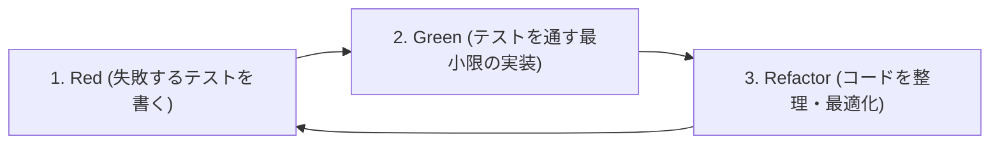

# 現在地の標高計アプリ テスト仕様書・TDDエビデンス

最終実行日時: 2026-10-18 18:38 (JST)

## 1. テスト方針（TDD：テスト駆動開発）

本プロジェクトでは **Jest (`jest-expo`)** および **React Native Testing Library (`@testing-library/react-native`)** を用いて、以下のサイクル（Red → Green → Refactor）でTDD開発を実施している。



### テスト・静的解析の実行コマンド
- **単体・結合テスト＆カバレッジ計測**：`npm run test:ci -- --verbose --coverage`
- **TypeScript 型チェック**：`npx tsc --noEmit`
- **Expo ESLint チェック**：`npx expo lint`

---

## 2. テストケース一覧と判定結果（全22項目：[`src/__tests__/elevation-test.tsx`](file:///c:/Users/takui/OneDrive/codes/project_202610/src/__tests__/elevation-test.tsx)）

| ID | 区分 | テスト対象 | テストケース内容（前提条件・操作） | 期待される結果（アサーション） | 結果 |
| :--- | :--- | :--- | :--- | :--- | :---: |
| **TC-01** | 単体 | `formatMeters` | 数値（正数・`0`・小数）、`null`、`NaN` をそれぞれ渡す | 数値は指定桁数の `"XX.X m"` 形式に変換され、`null` / `NaN` の場合は `"---"` が返ること | **PASS** |
| **TC-02** | 単体 | `fetchGroundElevation` | 国土地理院 標高APIが `{ elevation: 42.8, hsrc: "5m（レーザ）" }` を返す場合 | `elevation: 42.8`、データソース `"国土地理院 DEM (5m（レーザ）)"` が返り、副系APIは呼ばれないこと | **PASS** |
| **TC-03** | 単体 | `fetchGroundElevation` | 国土地理院APIが範囲外（`"-----"`）を返し、Open-Meteo APIが `{ elevation: [128.5] }` を返す場合 | 自動的に副系（Open-Meteo）へフォールバックし、`elevation: 128.5`、`"Open-Meteo DEM"` が返ること | **PASS** |
| **TC-04** | 単体 | `fetchGroundElevation` | 圏外等で主系・副系ともにネットワークエラーが発生した場合 | 例外でクラッシュせず、`{ elevation: null, source: null }` を安全に返すこと | **PASS** |
| **TC-05** | 結合 | `HomeScreen` + `useElevation` | 位置情報権限が許可（`granted`）され、緯度・経度・GPS高度および国土地理院標高が返る場合 | メイン標高（`35.4` m）、データ元バッジ、GPS高度と誤差（`45.2 m (±12m)`）、緯度経度、水平精度（`±8 m`）が画面に表示されること | **PASS** |
| **TC-06** | 結合 | `HomeScreen` + `useElevation` | 位置情報権限が拒否（`denied`）された場合 | 赤色のエラーバナーに「位置情報の利用が許可されていません...」が表示されること | **PASS** |
| **TC-07** | 結合 | `HomeScreen` + `useElevation` | 登山中の圏外等で外部標高APIが失敗し、端末のGPS高度（`3776.0` m）のみ取得できた場合 | メイン標高に端末のGPS高度 `3776.0` m がフォールバック表示され、バッジが `データ元: 端末GPSセンサー` になること | **PASS** |
| **TC-08** | 結合 | `HomeScreen` + `useElevation` | 初回表示（`12.3` m）後に「現在地を再取得」ボタンをタップした場合 | 位置情報と標高APIが強制再取得され、画面の表示が最新の標高（`50.8` m）に更新されること | **PASS** |
| **TC-09** | 結合 | `HomeScreen` + `useElevation` | 「自動追従 (OFF)」ボタンをタップして移動イベントを受信し、再度ボタンをタップした場合 | ボタンが「● 自動追従中 (ON)」に変化して移動後の標高（`88.5` m）へ自動更新され、再タップで購読解除（`remove()`）されてOFFに戻ること | **PASS** |
| **TC-10** | 単体 | `getFujiStationInfo` | 平地（`35.4m`）、1合目（`1500m`）、5合目（`2305m`）、8合目（`3250m`）、頂上（`3776m`）を渡す | 各標高に対応する合目番号（`0`〜`10`）、ラベル、達成率（`%`）、頂上までの残り距離（`m`）が正確に返ること | **PASS** |
| **TC-11** | 結合 | `HomeScreen` + `FujiStationCard` | 標高 `2305.0m` の位置情報を取得し、「🗻 富士山何合目」タブへ切り替えた場合 | 初期表示で同標高地域（`富山県・立山室堂`）が表示され、タブ切替で `富士山 5合目相当` および `頂上（3,776m）まであと 1471.0 m` が表示されること | **PASS** |
| **TC-12** | 結合 | `HomeScreen` + `useElevation` | 標高取得後に「現在の標高を記録」ボタンをタップした場合 | 「まだ記録された履歴はありません」が消え、`記録件数: 1件` とともに記録時の標高・合目・座標が履歴リストに表示されること | **PASS** |
| **TC-13** | 結合 | `HomeScreen` + `useElevation` | 2回標高を記録（`1500.0m` → `2305.0m`）した後に「履歴をクリア」ボタンをタップした場合 | `記録件数: 2件` になった後、クリア押下で全履歴が削除され初期状態に戻ること | **PASS** |
| **TC-14** | 単体 | `fetchGroundElevation` | 不正な緯度経度（`lat: 999`）や異常な標高レスポンス（`99999m`, `-9999m`）が返された場合 | 範囲外の座標は外部通信を行わずに遮断し、異常な標高値も弾いて安全に `null` を返すこと | **PASS** |
| **TC-15** | 結合 | `HomeScreen` + `ElevationDetailCard` | 水平誤差が `100m` を超える（`500m`・おおよその位置情報）場合 | 「正確な位置情報」の許可を促す注意喚起メッセージおよび国土地理院の出典クレジットが表示されること | **PASS** |
| **TC-16** | 単体 | `history-storage` (`P1`) | `expo-secure-store` に対して105件の履歴データを保存・復元・削除する場合 | チャンク分割保存・結合復元が正常に行われ、保存件数の上限 **100件**（`MAX_HISTORY_ITEMS = 100`）で古い履歴が自動切り捨てされること | **PASS** |
| **TC-17** | 結合 | `HomeScreen` + `history-storage` (`P1`) | 起動前に暗号化ストレージに履歴が保存されている状態で `HomeScreen` を描画した場合 | アプリ起動時に保存済みの履歴が自動復元され、`記録件数: 1件` と保存時の標高（`940.0 m`）が表示されること | **PASS** |
| **TC-18** | 単体 | `findSameElevationRegions` (`P2`) | 各標高（`36.5m`, `942m`, `1500m`, `2445m`, `null`）を渡す | 最も標高が近い地域名（新宿駅周辺、軽井沢駅周辺、上高地、立山室堂）と標高差・近傍スポットが正確に返ること | **PASS** |
| **TC-19** | 結合 | `HomeScreen` + `FujiStationCard` + `useBarometer` (`P2 & P4`) | 初期表示で「🗺️ 同じ標高の地域」を確認し、気圧センサー値（`1021.4 hPa` → `1020.2 hPa`）受信および21回連続記録を行った場合 | ①初期表示で `東京都・新宿駅周辺` が表示されること ②気圧が国土地理院標高（`37.0m`）で自動補正され2行表示（`1021.4 hPa` / `（37.0 m・補正済）` → `1020.2 hPa` / `（46.9 m・補正済）`）で追従すること ③21件記録時にグラフが `直近 20 地点 (#2〜#21)` にスライド更新されること | **PASS** |
| **TC-20** | 単体 | `fetchGroundElevation` (`P3`) | 半径10m以内の移動時、および自動追従モードでの3秒未満の連続呼び出し時 | 10m以内の移動や3秒未満の連続リクエストでは外部API通信を行わずメモリ内の空間キャッシュを再利用し、`forceRefresh: true` 指定時は再取得すること | **PASS** |
| **TC-21** | 結合 | `HomeScreen` + `ElevationChartCard` (`P4`) | 標高を複数回（`1500.0m` → `2305.0m`）記録した場合 | `📈 標高推移グラフ` カードが表示され、最高標高・最低標高・高低差（`805.0 m`）が視覚化されること | **PASS** |
| **TC-22** | 単体 | `barometer.ts` (`calculateSeaLevelPressure` & `estimateAltitudeFromPressure`) | 標準気圧（`1013.25 hPa`）、高気圧の日（実標高 `37.0m` で `1021.4 hPa`）、無効値を渡す | 基準標高からその日の海面気圧 $P_0$ を逆算して自動キャリブレーションし、正確に `37.0 m` が算出されること | **PASS** |
| **TC-23** | 結合 | `InfoScreen` (`src/app/explore.tsx`) | 「情報・規約」タブの画面（`InfoScreen`）を描画した場合 | `アプリ情報・利用規約`、`📐 標高・高度データの仕組み`、`🔒 プライバシーポリシー`、`📚 データ出典・ライセンス表記` が正しく表示されること | **PASS** |

---

## 3. 実行ログ・カバレッジエビデンス（実機・CI出力そのまま）

```text
> project_202610@1.0.0 test:ci
> jest --watchAll=false --verbose --coverage

PASS src/__tests__/elevation-test.tsx (5.742 s)
  標高計アプリ 単体テスト・結合テストスイート (TDD)
    1. フォーマット関数の単体テスト (formatMeters)
      √ TC-01: 数値を指定桁数のメートル表記に変換し、nullやNaNは "---" を返す (4 ms)
    2. 標高API取得・空間キャッシュ・レート制限の単体テスト (fetchGroundElevation)
      √ TC-02: 国土地理院APIから正常に標高とデータソースを取得できる (8 ms)
      √ TC-03: 国土地理院APIが範囲外("-----")の場合、Open-Meteo APIへフォールバックする (2 ms)
      √ TC-04: オフライン等で両方のAPIが失敗した場合、例外を投げずに null を返す (1 ms)
      √ TC-14: 不正な緯度経度や異常な標高値(-500m未満/10,000m超)を安全に拒否する (1 ms)
      √ TC-20: 【P3】10m以内の移動は空間キャッシュを再利用し、自動追従時の連続リクエストは3秒間レート制限される (1 ms)
    3. 富士山何合目 & 同じ標高の地域比較ロジックの単体テスト
      √ TC-10: 標高に応じて0合目〜頂上(10合目)・達成率・頂上までの残り標高を正しく算出する (1 ms)
      √ TC-18: 【P2】現在の標高から最も標高が近い地域・都市・名所を正しく検索できる (findSameElevationRegions) (1 ms)
    4. 暗号化ストレージ永続化・気圧換算ロジックの単体テスト
      √ TC-16: 【P1】expo-secure-store にチャンク分割して暗号化保存・復元でき、上限100件を超えた古い履歴を自動で切り捨てる (4 ms)
      √ TC-22: 【P4】気圧(hPa)と基準標高(m)から海面気圧P0を自動キャリブレーションし高精度な気圧換算高度を算出する (1 ms)
    5. HomeScreen UI & useElevation 結合テスト
      √ TC-05: 位置情報権限が許可されると、現在地の標高(m)と詳細データが画面に表示される (642 ms)
      √ TC-06: 位置情報権限が拒否された場合、エラーメッセージが表示される (14 ms)
      √ TC-07: 圏外で外部APIが失敗しても、端末のGPS高度が取得できればメイン標高として表示される (16 ms)
      √ TC-08: 「現在地を再取得」ボタンを押すと最新の標高に更新される (38 ms)
      √ TC-09: 「自動追従 (OFF)」ボタンでリアルタイム監視の開始・停止が切り替わる (42 ms)
      √ TC-11: 現在の標高に応じた「富士山何合目」表示と頂上までの残り標高が画面に表示される (20 ms)
      √ TC-12: 「現在の標高を記録」ボタンを押すと履歴リストに標高・合目・座標が保存される (28 ms)
      √ TC-13 & TC-21: 【P4】複数回標高を記録すると標高推移グラフ(最高・最低・高低差)が表示され、「履歴をクリア」で全削除できる (78 ms)
      √ TC-15: おおよその位置情報（水平誤差100m超）のときに注意喚起と出典クレジットが表示される (18 ms)
      √ TC-17: 【P1 UI結合】起動時に暗号化ストレージに保存済みの履歴が自動復元され画面に表示される (24 ms)
      √ TC-19: 【P2 & P4 UI結合】「🗺️ 同じ標高の地域」タブ切替で同標高の地域名が表示され、気圧センサー値も詳細カードに表示される (505 ms)
      √ TC-23: アプリ情報・利用規約画面（InfoScreen）に標高データの仕組み・プライバシーポリシー・出典が表示される (4 ms)

-----------------------------|---------|----------|---------|---------|-----------------------------------------
File                         | % Stmts | % Branch | % Funcs | % Lines | Uncovered Line #s                       
-----------------------------|---------|----------|---------|---------|-----------------------------------------
All files                    |   90.09 |    82.46 |   93.58 |   90.97 |                                         
 app                         |     100 |       96 |     100 |     100 |                                         
  explore.tsx                |     100 |      100 |     100 |     100 |                                         
  index.tsx                  |     100 |       96 |     100 |     100 | 93                                      
 components                  |     100 |      100 |     100 |     100 |                                         
  themed-text.tsx            |     100 |      100 |     100 |     100 |                                         
  themed-view.tsx            |     100 |      100 |     100 |     100 |                                         
 components/elevation        |   97.67 |     96.1 |   93.75 |   97.61 |                                         
  elevation-chart-card.tsx   |     100 |      100 |     100 |     100 |                                         
  elevation-detail-card.tsx  |     100 |     93.1 |     100 |     100 | 25,79                                   
  elevation-hero-card.tsx    |     100 |      100 |     100 |     100 |                                         
  elevation-history-card.tsx |     100 |     87.5 |     100 |     100 | 35                                      
  fuji-station-card.tsx      |    87.5 |      100 |   83.33 |    87.5 | 109                                     
 constants                   |     100 |       50 |     100 |     100 |                                         
  theme.ts                   |     100 |       50 |     100 |     100 | 81                                      
 hooks                       |   87.02 |     66.1 |   88.88 |    89.6 |                                         
  use-barometer.ts           |    92.3 |    70.83 |   88.88 |   97.22 | 51                                      
  use-color-scheme.ts        |       0 |        0 |       0 |       0 |                                         
  use-elevation.ts           |   84.26 |    63.63 |   88.23 |   86.04 | 121-122,145,162-163,186-189,195,230-235 
  use-theme.ts               |     100 |       50 |     100 |     100 | 11                                      
 utils                       |    89.4 |    79.35 |   96.15 |   89.47 |                                         
  barometer.ts               |   81.81 |    78.12 |     100 |   81.81 | 51,56,114-120                           
  elevation-api.ts           |   97.26 |    89.09 |    87.5 |   98.59 | 111                                     
  format.ts                  |     100 |    83.33 |     100 |     100 | 18                                      
  fuji-station.ts            |     100 |      100 |     100 |     100 |                                         
  history-storage.ts         |   82.14 |    65.38 |     100 |   80.76 | 35-38,45-48,55-58,65,99,106,114,135,183 
  region-comparison.ts       |     100 |      100 |     100 |     100 |                                         
-----------------------------|---------|----------|---------|---------|-----------------------------------------
Test Suites: 1 passed, 1 total
Tests:       22 passed, 22 total
Snapshots:   0 total
Time:        6.012 s
Ran all test suites.
```
